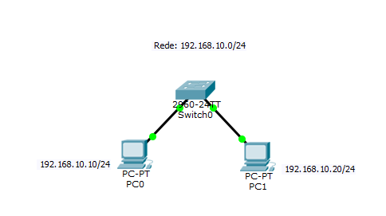
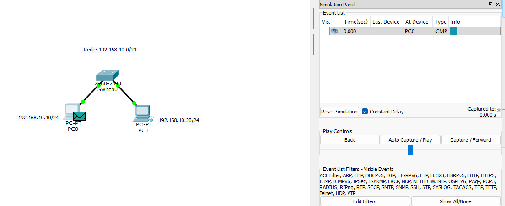

# Lab 01 — Comunicação em uma Rede Local

## Objetivo

Este laboratório tem como objetivo demonstrar, na prática, como dois computadores se comunicam dentro de uma mesma rede local utilizando um switch.

Durante o laboratório foram aplicados conceitos fundamentais de redes, como:

- Endereçamento IPv4
- Máscara de rede
- Endereço MAC
- ARP
- Ethernet
- Switch
- ICMP
- Ping

O objetivo principal é compreender o fluxo de comunicação entre dois hosts pertencentes à mesma rede.

---

## Topologia

A topologia utilizada é composta por:

- 2 computadores
- 1 switch
- Cabos Ethernet

Estrutura:

```text
PC0
192.168.10.10/24
        |
        |
      Switch
        |
        |
PC1
192.168.10.20/24
```

Os dois computadores pertencem à mesma rede:

```text
192.168.10.0/24
```

### Topologia no Packet Tracer



---

## Endereçamento IP

| Dispositivo | Endereço IP | Máscara | Gateway |
|---|---|---|---|
| PC0 | 192.168.10.10 | 255.255.255.0 | Não configurado |
| PC1 | 192.168.10.20 | 255.255.255.0 | Não configurado |

A máscara `255.255.255.0`, equivalente a `/24`, indica que os primeiros 24 bits representam a rede e os últimos 8 bits são utilizados para os hosts.

A rede utilizada é:

```text
192.168.10.0/24
```

Nesse caso:

```text
Endereço da rede: 192.168.10.0

Hosts utilizáveis:
192.168.10.1 até 192.168.10.254

Broadcast:
192.168.10.255
```

O gateway não foi configurado porque os dois computadores estão na mesma rede local. O gateway seria necessário caso os dispositivos precisassem acessar outra rede.

---

## Conceitos utilizados

### IPv4

O IPv4 fornece endereços lógicos para as interfaces de rede.

Neste laboratório:

```text
PC0 → 192.168.10.10
PC1 → 192.168.10.20
```

Como ambos utilizam `/24`, pertencem à mesma rede `192.168.10.0/24`.

---

### Endereço MAC

O endereço MAC é utilizado para identificar uma interface durante a comunicação dentro da rede local.

Enquanto o endereço IP identifica logicamente origem e destino, o endereço MAC é utilizado na entrega dos quadros Ethernet dentro da LAN.

---

### ARP

ARP significa **Address Resolution Protocol**.

Sua função é descobrir qual endereço MAC corresponde a um determinado endereço IPv4 dentro da rede local.

Por exemplo, quando o PC0 precisa enviar um quadro para o PC1, ele conhece:

```text
IP do PC1:
192.168.10.20
```

Porém, precisa descobrir o MAC correspondente.

O processo é semelhante a:

```text
PC0:
"Quem possui o IP 192.168.10.20?"

        ↓

ARP Request

        ↓

PC1:
"Eu possuo esse IP.
Este é o meu endereço MAC."

        ↓

ARP Reply
```

Após essa descoberta, a associação entre IP e MAC pode ser armazenada temporariamente na tabela ARP do computador.

---

### Switch

O switch conecta os dispositivos da rede local.

Ele trabalha principalmente com endereços MAC para decidir para qual porta deve encaminhar um quadro Ethernet.

Exemplo conceitual:

```text
MAC                         Porta

MAC do PC0                  Porta 1
MAC do PC1                  Porta 2
```

Quando um quadro destinado ao MAC do PC1 chega ao switch, ele pode encaminhá-lo para a porta onde o PC1 está conectado.

---

### ICMP e Ping

O comando `ping` foi utilizado para verificar a conectividade entre os dois computadores.

Exemplo executado no PC0:

```bash
ping 192.168.10.20
```

O `ping` utiliza o protocolo ICMP.

De forma simplificada:

```text
PC0
 |
 | ICMP Echo Request
 v
PC1

PC0
 ^
 | ICMP Echo Reply
 |
PC1
```

Quando o Echo Reply retorna, sabemos que existe comunicação IP entre os dispositivos.

---

## Fluxo da comunicação

Quando o PC0 tenta se comunicar com o PC1, ocorre o seguinte processo:

```text
PC0 quer acessar 192.168.10.20
            |
            v
Compara o IP de destino com sua máscara
            |
            v
Identifica que o destino está
na mesma rede 192.168.10.0/24
            |
            v
Não utiliza gateway
            |
            v
Precisa descobrir o MAC do PC1
            |
            v
           ARP
            |
            v
Descobre o endereço MAC do PC1
            |
            v
Monta o quadro Ethernet
            |
            v
           Switch
            |
            v
Switch encaminha o quadro
para a porta do PC1
            |
            v
           PC1
```

Esse processo demonstra a relação entre IP, MAC, ARP e Ethernet dentro de uma rede local.

---

## Pacote IP e quadro Ethernet

Na comunicação entre PC0 e PC1, podemos representar de forma simplificada:

```text
QUADRO ETHERNET

MAC origem:
MAC do PC0

MAC destino:
MAC do PC1

        ↓

PACOTE IP

IP origem:
192.168.10.10

IP destino:
192.168.10.20
```

Como os dois hosts estão na mesma rede, o MAC de destino é o MAC do próprio PC1.

Não é necessário enviar o tráfego para um roteador.

---

## Teste de conectividade

No PC0 foi utilizado:

```bash
ping 192.168.10.20
```

O objetivo do teste é verificar se o PC0 consegue alcançar o PC1.

### Evidência



---

## Verificação da tabela ARP

Após gerar comunicação entre os dispositivos, a tabela ARP pode ser consultada utilizando:

```bash
arp -a
```

Esse comando permite observar associações entre endereços IPv4 e endereços MAC conhecidos pelo host.

Exemplo conceitual:

```text
192.168.10.20 → MAC do PC1
```


## Análise com o modo Simulation

O modo **Simulation** do Cisco Packet Tracer permite acompanhar os protocolos utilizados durante a comunicação.

Na primeira comunicação entre os hosts, é possível observar o processo envolvendo:

```text
ARP
↓
descoberta do MAC

ICMP
↓
teste de conectividade
```

Fluxo simplificado:

```text
PC0
 |
 | ARP Request
 v
Switch
 |
 v
PC1

PC1
 |
 | ARP Reply
 v
PC0

PC0
 |
 | ICMP Echo Request
 v
PC1

PC1
 |
 | ICMP Echo Reply
 v
PC0
```


## O que aprendi

Com este laboratório foi possível compreender que dois dispositivos pertencentes à mesma rede IP não precisam de um roteador para se comunicar.

O endereço IP é utilizado para identificar logicamente origem e destino, enquanto o endereço MAC é utilizado para a entrega dos quadros dentro da rede local.

Também foi possível entender que o ARP relaciona um endereço IPv4 conhecido ao endereço MAC correspondente.

O switch utiliza os endereços MAC para encaminhar os quadros pela LAN.

Por fim, o comando `ping` utiliza ICMP e pode ser utilizado para testar a conectividade entre dois hosts.

O fluxo principal observado foi:

```text
IP de destino
↓
verificação da rede
↓
ARP
↓
MAC
↓
quadro Ethernet
↓
switch
↓
host de destino
```

---

## Próximo laboratório

No próximo laboratório será adicionada uma segunda rede e um roteador.

O objetivo será estudar:

- Gateway padrão
- Interfaces do roteador
- Comunicação entre redes diferentes
- Tabela de roteamento
- ARP envolvendo o gateway
- Encaminhamento de pacotes entre redes

Topologia prevista:

```text
192.168.10.0/24

PC
 |
Switch
 |
Roteador
 |
Switch
 |
Servidor

192.168.20.0/24
```

Esse laboratório permitirá comparar diretamente a comunicação dentro de uma mesma LAN com a comunicação entre redes diferentes.